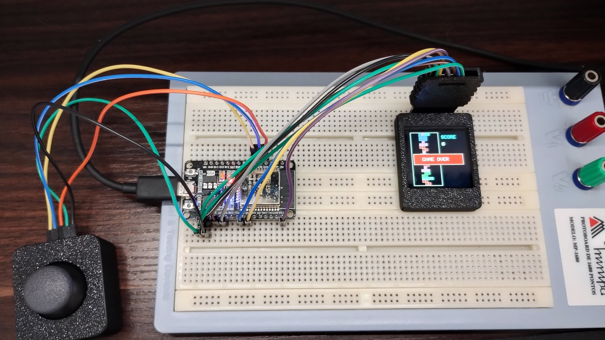

# 🕹️ ESP32 Tetris — 60 FPS & Analog Joystick

Modular, **object-oriented C++** implementation of the classic **Tetris** game for the **ESP32 DevKit V1** microcontroller, using a **1.54" TFT IPS ST7789 (240x240)** color display over hardware SPI and an **Analog Joystick (KY-023)** for input, with deterministic timing locked at **60 FPS**.

---

## ✨ Features and Architecture

* **Deterministic 60 FPS Loop:** Strict frame-rate control via `micros()` ($16.666\ \mu\text{s}$ per frame) with integer frame-counter based timing (*Frame-Based Timing*).
* **Flicker-Free Partial Rendering:** Only redraws the blocks that changed on the board using the `TFT_eSPI` library, keeping the visual response instantaneous.
* **Matrix-Based Logic:**
  * Fixed board matrix (`20x10`).
  * Templates for the 7 classic pieces (`I, J, L, O, S, T, Z`) top-aligned in a `4x4` grid, with rotation by matrix transposition.
  * Collision detection for walls, floor, locked pieces, *Block Out* and *Lock Out* (Game Over).
* **Dynamic Difficulty Progression:** The fall speed automatically increases every 500 accumulated points.
* **Modular Code:** Split between interface (`include/`) and implementation (`src/`), documented in the Doxygen standard.


---

## 🛠️ Bill of Materials (BOM)

| Component | Specification | Qty. |
| :--- | :--- | :---: |
| **Microcontroller** | ESP32-WROOM-32 DevKit V1 (30 pins) | 1 |
| **Graphic Display** | 1.54" TFT IPS LCD ST7789 ($240 \times 240$, SPI, 3.3V) | 1 |
| **Controller** | 2-Axis Analog Joystick Module + Button (KY-023) | 1 |
| **Prototyping** | Breadboard (830 points) + Male-Female / Male-Male jumpers | - |
| **Power** | Micro-USB / USB-C data cable connected to the PC or a 5V supply | 1 |

---

## 🔌 Wiring Diagram (Pinout)

> ⚠️ **Warning:** Power both the ST7789 display and the Joystick module exclusively from the ESP32's **3V3** pin. The ESP32 ADC operates in the `0V to 3.3V` range and the joystick's analog pins must be connected to the **ADC1** channels (`GPIO 34` and `GPIO 35`).

### 1. 1.54" TFT IPS ST7789 Display (VSPI Bus)

| Display Pin | ESP32 Silkscreen | GPIO in Code | Function |
| :--- | :--- | :---: | :--- |
| **GND** | `GND` | `GND` | Common ground |
| **VCC** | `3V3` | `3.3V` | Logic power |
| **SCL / SCK** | `D18` | `18` | SPI clock (*VSPI SCK*) |
| **SDA / MOSI** | `D23` | `23` | SPI data (*VSPI MOSI*) |
| **RES / RST** | `D4` | `4` | Controller reset |
| **DC** | `D2` | `2` | Command / Data select |
| **CS** *(optional)* | `D5` | `5` | Chip Select *(ignore if your module has 7 pins)* |
| **BLK / LED** | `3V3` | `3.3V` | Backlight (100%) |

### 2. Analog Joystick Module (KY-023)

| Joystick Pin | ESP32 Silkscreen | GPIO in Code | Function |
| :--- | :--- | :---: | :--- |
| **GND** | `GND` | `GND` | Common ground |
| **+5V / VCC** | `3V3` | `3.3V` | 3.3V voltage reference |
| **VRx** | `D34` | `34` | Horizontal axis (Left / Right) |
| **VRy** | `D35` | `35` | Vertical axis (Up = Rotate / Down = Soft drop) |
| **SW** | `D32` | `32` | Stick center button (Rotate / Restart) |

---

## 📂 Project Structure

```text
esp_tetris/
├── include/
│   ├── config.h          # Pinout, screen dimensions, FPS and piece templates
│   └── tetris.h          # Tetris class declaration (Doxygen documentation)
├── src/
│   ├── main.cpp          # Entry point: wires the game to the Arduino runtime
│   └── tetris.cpp        # Game engine: collisions, rotation and partial rendering
├── test/
│   ├── mocks/            # Arduino.h and TFT_eSPI.h mocks for native tests
│   ├── test_logic/       # Unit tests for the game logic (Unity)
│   └── test_integration/ # Integration tests for the game loop (Unity)
├── platformio.ini        # Board configuration, dependencies and TFT_eSPI flags
└── README.md
```

## 🚀 How to Build and Flash with PlatformIO (`pio`)

### Prerequisites

1. **PlatformIO Core (CLI)** installed, or the **PlatformIO IDE** extension in VS Code.
2. *(Linux)* Serial port access permissions configured for your user:
```bash
sudo usermod -aG dialout $USER
```

*(Restart your session after running the command if this is the first time).*

### Step 1: Clone the Repository

```bash
git clone https://github.com/mstuttgart/esp32-tetris.git
cd esp32-tetris
```

### Step 2: Check `platformio.ini`

The project already includes all the required `TFT_eSPI` flags (including `-D LOAD_GLCD=1` for rendering the score font):

```ini
[env:upesy_wroom]
platform = espressif32
board = upesy_wroom
framework = arduino
monitor_speed = 115200

lib_deps = bodmer/TFT_eSPI@^2.5.43

build_flags =
    -D DISABLE_ALL_LIBRARY_WARNINGS=1
    -D USER_SETUP_LOADED=1
    -D ST7789_DRIVER=1
    -D TFT_WIDTH=240
    -D TFT_HEIGHT=240
    -D TFT_MOSI=23
    -D TFT_SCLK=18
    -D TFT_CS=5       ; Use -1 if your board is the 7-pin model (no CS)
    -D TFT_DC=2
    -D TFT_RST=4
    -D LOAD_GLCD=1
    -D LOAD_FONT2=1
    -D SPI_FREQUENCY=40000000
```

### Step 3: Build the Firmware

From the project root, run the command below to automatically download the `TFT_eSPI` library and compile the code:

```bash
pio run
```

### Step 4: Flash the Board (Upload)

Connect the ESP32 DevKit V1 to the USB port and run:

```bash
pio run -t upload
```

> **Flashing tip:** If the terminal hangs at `Connecting........_____.....`, hold down the physical **BOOT** button on the ESP32 board until the write percentage starts (`Writing at 0x00001000...`), then release it.

### Step 5: Serial Monitor (Optional)

To follow the boot logs:

```bash
pio device monitor -b 115200
```

---

## 🧪 Automated Tests

The project includes **unit tests** (`test/test_logic/`) and **integration tests** (`test/test_integration/`) written with the **Unity** framework (bundled with PlatformIO). They run **on the PC** (the `native` environment), with no ESP32 required, using mocks of the Arduino core and `TFT_eSPI` (`test/mocks/`) that simulate the joystick, button, clock (`micros()`) and piece randomization.

```bash
pio test -e native
```

* **Unit:** collision (walls, floor and locked blocks), rotation (including blocked rotation), line clearing, score/level, piece locking and *Game Over* conditions.
* **Integration:** drive `Tetris::update()` frame by frame — gravity at 60 FPS, joystick movement, *soft drop*, *edge-triggered* rotation, full drop with next-piece spawn, stacking up to *Game Over* and restart via the button.

---

## 🎮 In-Game Controls

* **Move Left / Right:** Push the stick along the **X** axis.
* **Rotate Piece (90° clockwise):** Push the stick **Up** or press the center button (**SW**).
* **Soft Drop:** Hold the stick **Down**.
* **Restart after Game Over:** Press the center button (**SW**).

---

## 🔧 Quick Calibration (If the Axes Are Inverted)

Depending on the physical orientation in which the joystick module is placed on the breadboard, if **Left/Right** or **Up/Down** end up inverted, simply swap the `< JOYSTICK_DEADZONE_LOW` and `> JOYSTICK_DEADZONE_HIGH` comparisons inside `Tetris::update()` in `src/tetris.cpp`.
